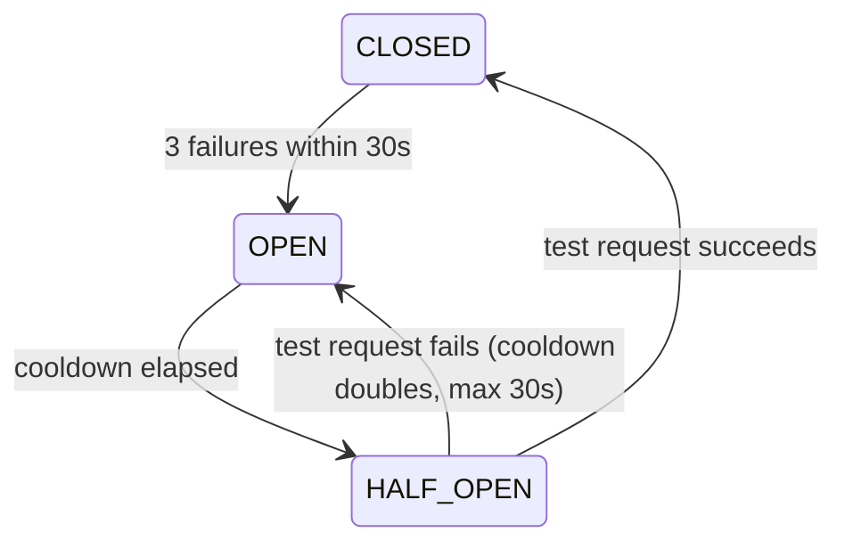

# Event Management API

A small Fastify service for viewing and scheduling events. It sits in front of an external event service (`http://event.com`), which is simulated locally with [MSW](https://mswjs.io/), so the project runs without any real backend.

## Getting started

Requirements: Node.js 20.11 or newer (`.nvmrc` pins 24).

```bash
nvm use            # optional
npm install
cp .env.example .env
npm start
```

The API listens on http://localhost:3000.

`npm start` loads variables with Node's built-in `--env-file` flag, so the `.env` file must exist. The service exits on startup if `EVENT_BASE_URL` is missing.

## Configuration

| Variable                    | Default | Description                                                         |
| --------------------------- | ------- | ------------------------------------------------------------------- |
| `PORT`                      | `3000`  | HTTP port                                                           |
| `EVENT_BASE_URL`            | none    | Base URL of the event service. Use `http://event.com` for the mock |
| `BREAKER_FAILURE_THRESHOLD` | `3`     | Failures inside the window that open the circuit breaker            |
| `BREAKER_WINDOW_MS`         | `30000` | Window used to count failures                                       |
| `BREAKER_COOLDOWN_MS`       | `5000`  | First wait before the breaker lets a test request through           |
| `BREAKER_MAX_COOLDOWN_MS`   | `30000` | Upper limit for the cooldown, which doubles after each failed test  |

## API reference

| Method | Path                     | Success                | Errors                                                     |
| ------ | ------------------------ | ---------------------- | ---------------------------------------------------------- |
| GET    | `/getUsers`              | `200` list of users    | `500` event service failed                                 |
| GET    | `/getEvents`             | `200` list of events   | `500` event service failed                                 |
| GET    | `/getEventsByUserId/:id` | `200` user's events    | `404` unknown user, `502` event service failed             |
| POST   | `/addEvent`              | `200` `{ success: true }` | `400` invalid body, `404` unknown user, `503` service unavailable (with `Retry-After` when the breaker is open) |

`POST /addEvent` body:

```json
{ "name": "hello", "userId": "3", "details": "optional" }
```

`name` and `userId` are required strings. Unknown fields are rejected.

```bash
curl -X POST http://localhost:3000/addEvent \
  -H 'Content-Type: application/json' \
  -d '{"name": "hello", "userId": "3"}'
```

## Architecture

```
services/index.js     routes, upstream calls
utils/breaker.js      circuit breaker used by /addEvent
utils/logger.js       console logger
mock-server/          MSW handlers that simulate http://event.com
```

### Fetching a user's events

`/getEventsByUserId` loads the user, then fetches each of their events. The mock's `getEventById` waits 500ms on purpose, and the original code fetched events one after another, so response time grew by 500ms per event.

The event requests now run in parallel with `Promise.all`, so the endpoint takes roughly one upstream round trip no matter how many events the user has. For a user with 7 events that's about 3.5s one by one, compared with about 0.5s measured locally after the change. Results keep the same order as the user's event list. If any event fails to load, the whole request returns `502`.

### Circuit breaker on /addEvent

The upstream `addEvent` endpoint can only handle a limited number of requests. The mock accepts 5 requests, rejects the next 10 with `503`, then starts over. `utils/breaker.js` wraps the call so that the service stops sending requests to the upstream while it's down.



- **CLOSED**: requests go through. Network errors, timeouts (5s) and `5xx` responses count as failures. `4xx` responses don't.
- **OPEN**: requests are rejected right away with `503` and a `Retry-After` header, without calling the upstream.
- **HALF_OPEN**: a single test request goes through. Any other request gets `503` until it finishes. If it succeeds the breaker closes and the cooldown resets to 5s. If it fails the breaker opens again with double the cooldown.

The user is checked with `getUserById` before calling `addEvent`. Without that check, a request with an unknown `userId` makes the mock fail with a server error and would count against the breaker.

## Testing

```bash
npm test
```

Runs the breaker unit tests with Node's built-in test runner (`node:test`). Timers are mocked, so the tests don't actually wait 30 seconds.

Manual checks against the running service:

```bash
# performance: add a few events, then time the lookup
for i in 1 2 3 4 5; do
  curl -s -X POST localhost:3000/addEvent -H 'Content-Type: application/json' -d '{"name":"e'$i'","userId":"1"}'
done
curl -s -o /dev/null -w "%{time_total}s\n" localhost:3000/getEventsByUserId/1

# resilience: keep posting and watch the status codes and Retry-After
for i in $(seq 1 12); do
  curl -s -D - -o /dev/null -X POST localhost:3000/addEvent \
    -H 'Content-Type: application/json' -d '{"name":"x","userId":"1"}' | grep -iE "^HTTP|retry-after"
done
```

## Roadmap

Things a production deployment would still need. They're listed here rather than built, to stay within the time limit of the exercise.

- **Linting and formatting**: ESLint and Prettier, run on a pre-commit hook.
- **CI**: GitHub Actions running lint and tests on every pull request.
- **Container**: a Dockerfile (Node LTS alpine, `npm ci --omit=dev`, non-root user) plus `.dockerignore`. The server would also need to listen on `0.0.0.0`.
- **Health check**: a `/health` endpoint for load balancers and orchestrators.
- **API docs**: an OpenAPI spec generated from the route schemas with `@fastify/swagger`.
- **One logger**: replace `utils/logger.js` with Fastify's built-in pino logger (`request.log`) so every log line is structured JSON with a request id.
- **Route tests**: export the Fastify app instead of starting it on import, then test routes with `fastify.inject()`.
- **Error handling**: a custom error handler so upstream error messages aren't sent back to clients.
- **Graceful shutdown**: close the server on `SIGTERM` so in-flight requests finish.
- **Concurrency limit and caching** for `/getEventsByUserId` (see limitations).

## Known limitations

- `/getEventsByUserId` starts every event request at once. A user with thousands of events would send thousands of requests to the upstream at the same time. A limit of around 10 at a time, or a batch endpoint upstream, would fix that.
- The breaker state lives in memory, so each instance of the service has its own breaker. Running several instances would need shared state (e.g. Redis).
- Event ids come from `Date.now()`, so two events created in the same millisecond would collide.
- `/getUsers` and `/getEvents` fail about 5% of the time by design of the mock. Those failures surface as `500` using Fastify's default error handler, which includes the upstream error message.
- There are two loggers: Fastify's request logs (JSON) and `utils/logger.js` (plain text).

---

## Design decisions

Notes for reviewers on what changed from the original repository and why.

### Task 1: project setup

- **`.gitignore`**: `node_modules` and all `.env*` files except `.env.example`.
- **Environment config**: the upstream URL and port were hardcoded. They now come from environment variables, loaded with Node's `--env-file` so no `dotenv` dependency is needed. `.env.example` documents every variable.
- **Fail fast**: the service exits on startup if `EVENT_BASE_URL` isn't set, and exits with code `1` (instead of `0`) if the server can't start.
- **Input validation**: `/addEvent` has a JSON schema, so invalid bodies get a `400` before reaching the upstream. The schema also stops clients from overriding the generated `id`.
- **Upstream error handling**: every upstream call checks `resp.ok` and has a 5s timeout. Before, error responses were forwarded as if they were successful, and a request could hang indefinitely.
- **Tests**: `npm test` runs `node:test`. Nothing extra to install.
- **Node version**: `engines` in `package.json` and `.nvmrc`. 20.11 is the minimum for `--env-file` and mocked `Date` in `node:test`.
- **Logging**: added log lines for each route and every breaker state change.

### Task 2: performance

Sequential `await` in a loop was replaced with `Promise.all`. Results come from the mapped promises rather than being pushed into a shared array, so the response order matches the user's event list. The intentional 500ms delay in the mock is untouched.

The old handler also didn't handle unknown users: it tried to read `events` from an empty response and crashed with a `500`. It now returns `404`.

### Task 3: resilience

The breaker is written from scratch as required, in about 60 lines with no dependencies. Some of the choices:

- **Sliding window**: failure timestamps older than 30s are dropped, so occasional failures spread over time don't open the breaker.
- **Exponential backoff**: this is how load is reduced while the upstream is down. Each failed test doubles the cooldown (5s, 10s, 20s, 30s max), so the longer the outage lasts, the less often it gets tested.
- **One test request at a time** in `HALF_OPEN`, so a recovering service doesn't get hit by a burst of traffic.
- **No automatic retries** of client requests. Retrying inside the service would add more load to an upstream that is already overloaded. Clients get `503` with `Retry-After` and decide when to try again.
- **Only server-side failures count**: `4xx` responses mean the request was wrong, not that the service is down.

### Changes vs the original repository

| File                    | Change                                                                                   |
| ----------------------- | ---------------------------------------------------------------------------------------- |
| `services/index.js`     | env config, timeouts, `resp.ok` checks, schema validation, user check, breaker, parallel fetch, status codes, logging |
| `utils/breaker.js`      | new: circuit breaker                                                                     |
| `utils/breaker.test.js` | new: breaker unit tests                                                                  |
| `package.json`          | `start` loads `.env`, real `test` script, `engines`, fixed `main`                        |
| `.env.example`          | new                                                                                      |
| `.gitignore`            | new                                                                                      |
| `.nvmrc`                | new                                                                                      |
| `README.md`             | this document                                                                            |
| `mock-server/`          | unchanged                                                                                |
| `utils/logger.js`       | unchanged                                                                                |
