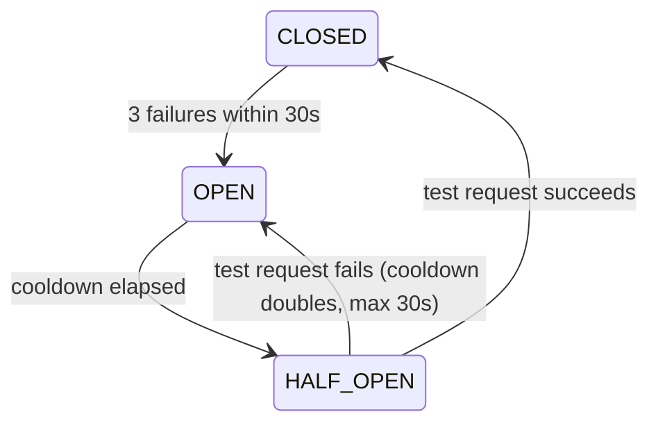

# Event Management API

Fastify service in front of `http://event.com`, which is mocked locally with MSW.

## Run

Requires Node 20.11+.

```bash
npm install
cp .env.example .env
npm start      # http://localhost:3000
npm test       # breaker unit tests
```

## Configuration

| Variable                    | Default            | Description                              |
| --------------------------- | ------------------ | ---------------------------------------- |
| `PORT`                      | `3000`             | HTTP port                                |
| `EVENT_BASE_URL`            | `http://event.com` | Event service URL                        |
| `BREAKER_FAILURE_THRESHOLD` | `3`                | Failures that open the breaker           |
| `BREAKER_WINDOW_MS`         | `30000`            | Window for counting failures             |
| `BREAKER_COOLDOWN_MS`       | `5000`             | Initial wait before retrying the service |
| `BREAKER_MAX_COOLDOWN_MS`   | `30000`            | Max wait (doubles after each failure)    |

## Changes from the original

| File                    | Change                                                                                                     |
| ----------------------- | ---------------------------------------------------------------------------------------------------------- |
| `.env.example`          | New. Adds `PORT`, `EVENT_BASE_URL` and the four `BREAKER_*` variables                                      |
| `.gitignore`            | New. Ignores `node_modules` and `.env*` (keeps `.env.example`)                                             |
| `.nvmrc`                | New. Node 24                                                                                               |
| `package.json`          | `start` loads `.env`, `test` runs `node --test`, `engines` >= 20.11, `main` points to `services/index.js` |
| `services/index.js`     | Env config, 5s timeouts, `resp.ok` checks, body schema, user check, breaker, parallel fetch, status codes  |
| `utils/breaker.js`      | New. Circuit breaker                                                                                       |
| `utils/breaker.test.js` | New. Breaker unit tests                                                                                    |
| `mock-server/`          | Unchanged                                                                                                  |

## Endpoints

| Endpoint                     | Responses                                                       |
| ---------------------------- | --------------------------------------------------------------- |
| `GET /getUsers`              | `200`, `500` if the event service fails                         |
| `GET /getEvents`             | `200`, `500` if the event service fails                         |
| `GET /getEventsByUserId/:id` | `200`, `404` unknown user, `502` if the event service fails     |
| `POST /addEvent`             | `200`, `400` bad body, `404` unknown user, `503` + `Retry-After` |

## Task 1: project setup

- `.gitignore` and `.env.example`.
- URL and port moved to env vars, loaded with Node's `--env-file` (no `dotenv`). Defaults match the original hardcoded values.
- `/addEvent` validates its body with a JSON schema (`400` on bad input).
- Upstream calls check `resp.ok` and time out after 5s.
- `npm test` uses the built-in `node:test`.
- Node version pinned in `.nvmrc` and `engines`.

**Not done (time limit):** ESLint/Prettier, CI, Dockerfile, `/health` endpoint, route tests with `fastify.inject()`, a single structured logger (pino).

## Task 2: performance

`/getEventsByUserId` fetched each event one after another, and each call takes 500ms in the mock. They now run in parallel with `Promise.all`, so it costs one round trip instead of 500ms per event (5 events: ~2.5s before, ~0.5s measured after). Results keep the user's event order. Unknown users now return `404` instead of crashing.

## Task 3: resilience

`/addEvent` goes through a small circuit breaker (`utils/breaker.js`, no libraries).



- **CLOSED**: requests pass. Timeouts and `5xx` count as failures, `4xx` don't.
- **OPEN**: requests fail immediately with `503` and a `Retry-After` header.
- **HALF_OPEN**: one test request is let through.

No automatic retries: they would add load to a service that's already failing. The client gets `Retry-After` and decides.

## Bug found

`POST /addEvent` with an unknown `userId` crashed the mock (`addEventTouUser` reads `users[userId].events` on `undefined`), which returned a `500`. The breaker counted it as an outage, so three bad requests would open the breaker and block `/addEvent` for every user.

**Fix:** the service calls `getUserById` before `addEvent` and returns `404` for unknown users. The upstream is never called, so the breaker isn't affected. The mock is left unchanged.

## Known limitations

- `/getEventsByUserId` has no concurrency limit; a user with thousands of events sends thousands of requests at once.
- Breaker state is in memory, so each instance has its own.
